# GreenLeaf Community Food Bank Website

GreenLeaf Community Food Bank began with a simple idea: neighbours helping neighbours. What started as a small WhatsApp group for sharing surplus food has grown into a community network of volunteers, donors, and local partners working together to make sure no one goes hungry.

Today, we distribute more than 1,200 food parcels every month, run a weekend soup kitchen that welcomes anyone who needs a hot meal, and work with 18 local businesses through regular donation drop-offs. Behind it all are more than 340 volunteer hours every month, driven by people who believe that a stronger community starts with looking out for one another.

At GreenLeaf, we believe access to food should never come with judgment. Every person deserves to be treated with dignity, and every family should be able to count on consistent support when they need it. That is why everything we do is built around dignity, transparency, and community.

## Contents

1. [Project overview](#project-overview)
2. [Pages](#pages)
3. [Repository structure](#repository-structure)
4. [How to preview locally](#how-to-preview-locally)
5. [Part 2: CSS and styling](#part-2-css-and-styling)
6. [Responsive design](#responsive-design)
7. [Screenshot evidence](#screenshot-evidence)
8. [Part 3: JavaScript enhancements](#part-3-javascript-enhancements)
9. [Changelog](#changelog)
10. [References](#references)

---

## Project overview

The website includes:

- 5 HTML pages with a shared header, navigation, and footer
- One external CSS stylesheet
- Responsive layouts for desktop, tablet, and mobile
- Responsive images using `<picture>`
- Forms for donations, volunteering, partnerships, and assistance requests
- Responsive schedule tables
- Screenshot evidence at three viewport sizes
- JavaScript in the `js/` folder (Part 3)

---

## Pages

| Page         | File                | Description                                        |
| ------------ | ------------------- | -------------------------------------------------- |
| Home         | `index.html`        | Introduction, statistics, and services preview     |
| About Us     | `about.html`        | Organisation background, mission, and values       |
| Our Services | `services.html`     | Food bank services and schedules                   |
| Get Involved | `get-involved.html` | Donate, volunteer, partner, and request assistance |
| Contact      | `contact.html`      | Contact information and enquiry form               |

---

## Repository structure

```
greenleaf/
├── index.html           Home page
├── about.html           About Us page
├── services.html        Our Services page
├── get-involved.html    Get Involved page
├── contact.html         Contact page
├── README.md            Project documentation
├── css/
│   └── style.css        External stylesheet
├── js/                  JavaScript (Part 3)
│   ├── accordion.js     FAQ accordion on Get Involved
│   ├── animations.js    Scroll reveal and animated counters
│   ├── lightbox.js      Photo gallery pop-up on Get Involved
│   └── menu.js          Mobile menu button
├── images/              Site images and responsive variants
└── screenshots/         Desktop, tablet, and mobile evidence
```

---

## How to preview locally

**Option 1: Open directly**

Open `index.html` in a web browser.

**Option 2: VS Code Live Server** (recommended for live reloading and reliable relative paths)

1. Open the project in VS Code.
2. Install the Live Server extension.
3. Right-click `index.html`.
4. Select **Open with Live Server**.

**Testing responsive layouts**

Resize the browser window or use the browser's developer tools device toolbar at these widths:

| Device  | Width  |
| ------- | ------ |
| Desktop | 1440px |
| Tablet  | 768px  |
| Mobile  | 375px  |

---

## Part 2: CSS and styling

### External stylesheet

All styling lives in one external stylesheet, `css/style.css`, which is linked from all five HTML pages. It is organised into numbered sections:

1. CSS Reset
2. CSS Variables
3. Base Styles
4. Typography
5. Layout: Header, Navigation, Footer
6. Layout: Page sections (Grid and Flexbox)
7. Components: Cards, Tables, Forms, Buttons
8. Visual styles: Status colours
9. Responsive: Tablet
10. Responsive: Mobile

### CSS reset and base styles

A lightweight reset gives consistent styling across browsers. It covers:

- `box-sizing`
- Margin and padding resets
- List styling
- Table borders
- Site-wide font, colour, and line-height defaults

### Typography

One Google Font is used for the whole site (Google Fonts, no date b):

| Font        | Used for                                                           |
| ----------- | ------------------------------------------------------------------ |
| Google Sans | Headings, site name, body text, navigation, form labels and tables |

Font sizes use `rem` and `clamp()` so text scales with browser settings and viewport size.

### Layout

**Flexbox** is used for layouts that need to reflow depending on the number of items (Mozilla Developer Network, no date a):

- Hero section
- Statistics cards
- Service cards
- Values list
- Get Involved forms
- Contact page columns

**CSS Grid** is used for the footer, because it has three fixed areas: address, contact information, and copyright. The layout is defined with `grid-template-areas` (Mozilla Developer Network, no date b).

### Layout wrappers added to the HTML

Extra wrapper elements were added so these sections could be controlled with Flexbox and Grid:

| Wrapper          | Purpose                                    |
| ---------------- | ------------------------------------------ |
| `.service-cards` | Home page service card layout              |
| `.help-grid`     | Get Involved form cards                    |
| `.contact-grid`  | Contact details beside the form            |
| `.media-row`     | Services page image beside its description |
| `.table-scroll`  | Horizontal scrolling for schedule tables   |

### Visual styling

The stylesheet includes colour variables, background colours, borders, box shadows, and card styling, along with interactive states for links, navigation, form inputs, and buttons:

- `:hover`
- `:focus`
- `:active`

---

## Responsive design

The site uses media queries at 1024px and 640px for the layout, plus a third at 768px for the mobile menu (Mozilla Developer Network, no date d).

### Desktop (wider than 1024px)

- Side-by-side hero
- 4-column statistics
- 3-column service cards
- 2×2 Get Involved form grid
- 2-column Contact layout
- 3-column footer

### Tablet (1024px and below)

- Statistics change to 2 columns
- Service cards change to 2 columns
- Get Involved sections stack
- Contact sections stack
- Spacing is reduced

### Mobile (640px and below)

- Single-column layouts
- Navigation stacks vertically
- Slightly smaller base font size
- Schedule tables scroll horizontally inside `.table-scroll` instead of squashing
- Spacing is reduced further

### Responsive images

Content images use the HTML `<picture>` element so smaller screens download smaller files (Mozilla Developer Network, no date c). Each image has two variants:

| Variant | Used for            | Example                 |
| ------- | ------------------- | ----------------------- |
| 400w    | Screens up to 640px | `food-parcels-400w.jpg` |
| 800w    | Larger screens      | `food-parcels-800w.jpg` |

---

## Screenshot evidence

Screenshots were captured with a headless rendering tool at 1440px (desktop), 768px (tablet), and 375px (mobile). Full-size images are in the `screenshots/` folder.

### Home

| Desktop | Tablet | Mobile |
| ------- | ------ | ------ |
| 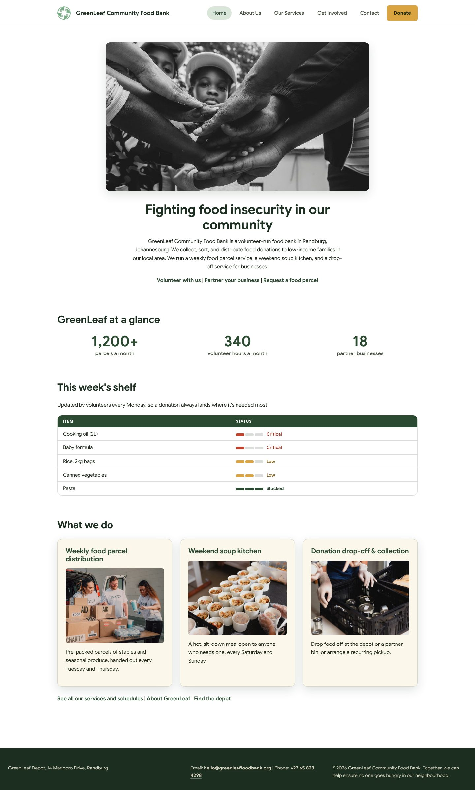 | 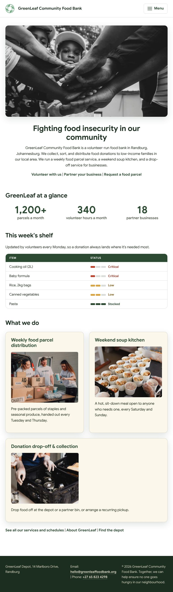 | 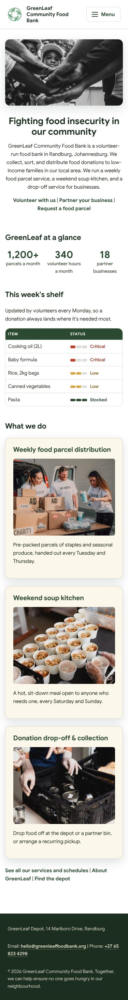 |

### Get Involved

| Desktop | Tablet | Mobile |
| ------- | ------ | ------ |
| 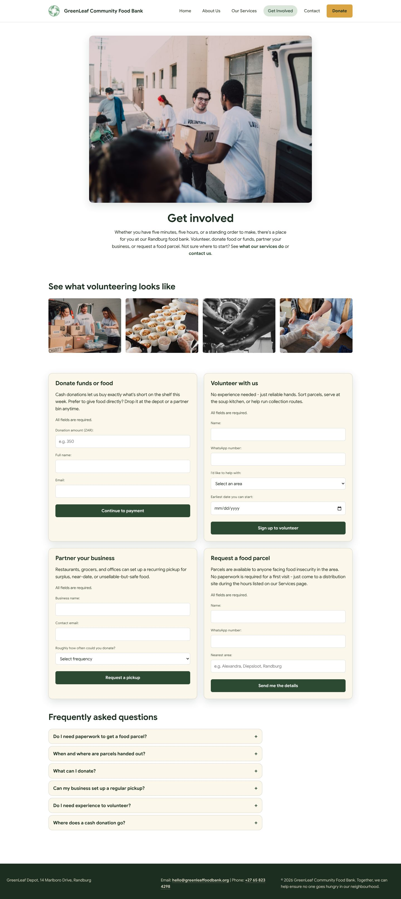 | 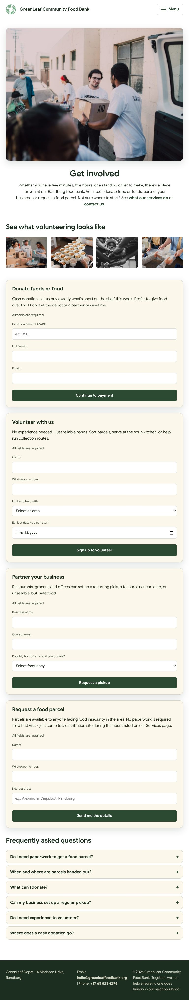 | 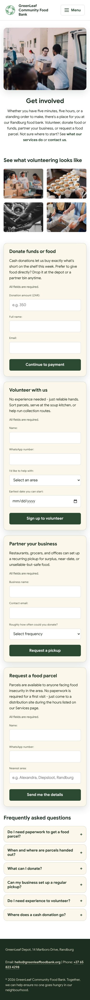 |

### Services

| Desktop | Tablet | Mobile |
| ------- | ------ | ------ |
| 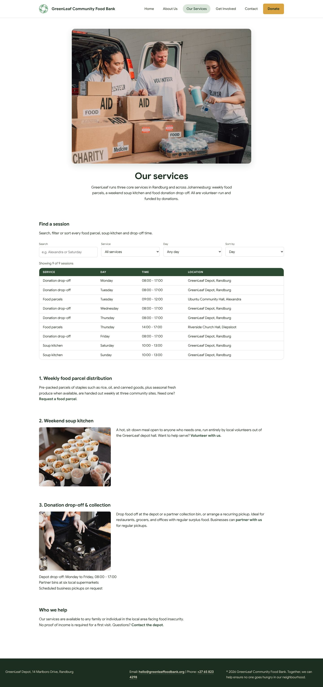 | 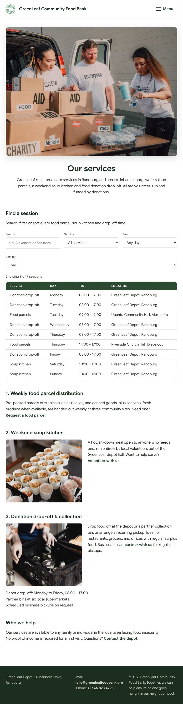 | 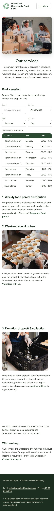 |

### About

| Desktop | Mobile |
| ------- | ------ |
| 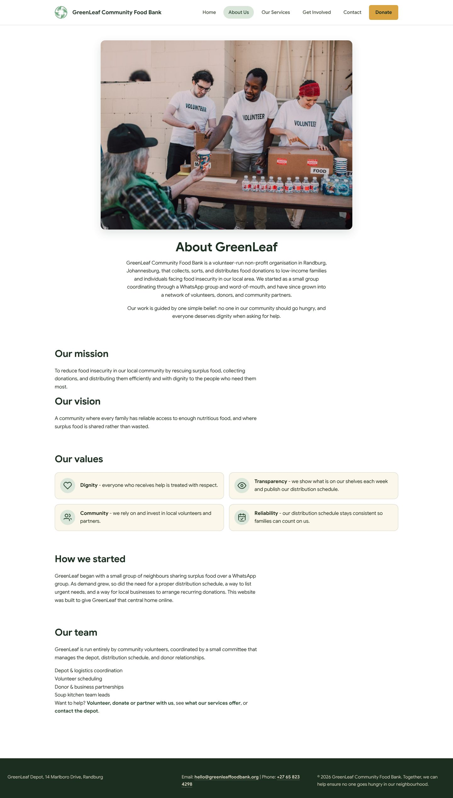 | 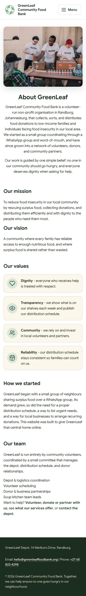 |

### Contact

| Desktop | Mobile |
| ------- | ------ |
| 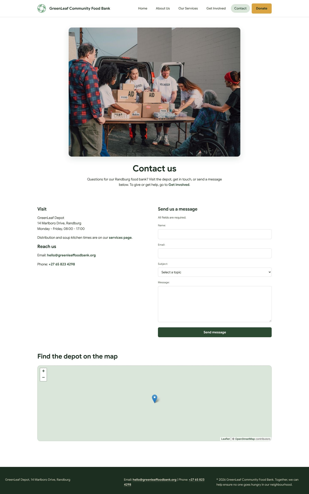 | 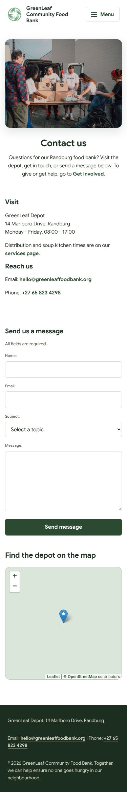 |

---

## Part 3: JavaScript enhancements

Part 3 adds interactivity with plain JavaScript (no frameworks). Each item is documented in the Changelog as it is completed.

| Brief item                          | Status                                                         |
| ----------------------------------- | -------------------------------------------------------------- |
| 2.1 Accordion, tabs or modal        | Done: FAQ accordion on the Get Involved page (`js/accordion.js`) |
| 2.1 Interactive map                 | Not started                                                    |
| 2.1 Animations and transitions      | In progress: scroll reveal and counters done (`js/animations.js`) |
| 2.1 Advanced DOM manipulation       | In progress: mobile menu button built with JavaScript (`js/menu.js`) |
| 2.1 Gallery with lightbox           | Done: photo gallery on Get Involved opens in a lightbox (`js/lightbox.js`) |
| 2.2 Dynamic content loading         | Not started                                                    |
| 2.2 Search, filter and sort         | Not started                                                    |
| Form validation                     | Not started                                                    |
| SEO best practices                  | Not started                                                    |
| Deployment on a free platform       | Live on GitHub Pages                                           |
| Supporting change: shelf table      | Done: stock-level bars on Home (CSS only, no JavaScript)       |

For now, the forms use `action="#"` and do not submit data to a backend.

---

## Changelog

Newest changes first.

### Part 3: SVG icons for the four values (About page)

- **What:** Each of the four values (Dignity, Transparency, Community, Reliability) now has a small icon in a round green badge beside its text. The icons are a heart, an eye, two people and a calendar with a tick.
- **Why:** The values were plain text in boxes. Icons make them quicker to scan, and they use the site's own green so they sit on theme.
- **Files changed:**
  - `about.html`: each value `<li>` now holds an inline `<svg class="value-icon">` followed by the text in a `<p>`.
  - `css/style.css`: new `.value-icon` rules (badge size, colours, line style), the value cards became a row (icon then text), and `#values li p` has no extra margin.
  - `README.md`: this entry.
  - `about.html` (wording): the Transparency value used to say "we publish how donations are used", but no page showed that. It now says "we show what is on our shelves each week and publish our distribution schedule", which the Home page shelf table and the Services schedule tables already do.
- **How it works:**
  - **Inline SVG:** the icons are written straight into the HTML on a 24 by 24 grid (`viewBox="0 0 24 24"`), so they need no extra file or request and stay sharp at any size.
  - **Theme colours from CSS:** `fill: none` with `stroke: var(--green)` draws each icon as an outline in the main green. The badge is a circle (`border-radius: 50%`) filled with `var(--green-tint)`. Changing those two variables recolours every icon.
  - **Accessibility:** the icons are decoration, because each value already has a text label, so they carry `aria-hidden="true"` and screen readers skip them.
  - **Layout:** each card is Flexbox (`display: flex`, icon then text). The cards still sit two per row and drop to one per row on phones.
- **How to test:** Open About and scroll to "Our values". Each card should show a green outline icon in a pale green circle. Narrow the window to a phone width: the cards stack in one column and the icons stay round.

### Part 3: Photo gallery lightbox and matching page heroes

- **What:**
  - Get Involved has a new "See what volunteering looks like" section with four photo thumbnails. Clicking one opens it large in a pop-up (a lightbox) with a caption, "Photo 2 of 4", Previous, Next and Close buttons.
  - The first photo on About, Our Services, Contact and Get Involved now follows the Home layout: photo on top (800px wide at most, centred), then the heading and text underneath.
- **Why:** The brief asks for a gallery with a lightbox. The volunteering photos also help motivate visitors to sign up. The other pages had small photos beside or under the heading, which did not match the Home page.
- **Files changed:**
  - `js/lightbox.js` (new): builds the pop-up and controls it.
  - `get-involved.html`: the hero photo is now first (800px), a new `#gallery` section with four links wrapping thumbnails (each link holds the big photo in `href` and the caption in `data-caption`), and the `lightbox.js` script tag.
  - `about.html`: the depot photo moved above the heading into a `page-hero` section.
  - `services.html`: the food parcels photo moved from beside the first service to the top of the page as the hero. The first service now shows text and its schedule table.
  - `contact.html`: the map photo moved out of the details column into a new `#contact-intro` hero section with a one-line intro. The details and the form stay side by side below it.
  - `css/style.css`: the Home hero rules now also apply to `.page-hero` (one set of rules for all five pages), plus new `.gallery` (4 columns, 2 on phones) and `.lightbox` rules.
- **How it works:**
  - **Page heroes:** `.page-hero` is the same Flexbox column as `#hero`. The picture is `width: 100%` with `max-width: 800px`, so it is never stretched past its real size.
  - **Lightbox:** the script finds every `.gallery a`, creates a `<dialog>` with `document.createElement`, and opens it with `showModal()` when a thumbnail is clicked. `showModal()` shows the dark `::backdrop` and makes the rest of the page inert while it is open (Mozilla Developer Network, no date l). `event.preventDefault()` stops the link from leaving the page. Previous and Next use `(n + total) % total` so they wrap round. Arrow keys also move between photos. Escape, the Close button and a click on the dark area all close it; in testing, focus returned to the thumbnail afterwards.
  - **Without JavaScript:** the thumbnails are ordinary links, so each one just opens the full photo.
- **How to test:** Open Get Involved and scroll to the gallery. Click a photo: the pop-up opens with a caption. Press the left and right arrow keys, then Escape. Click Next on the last photo and it wraps to the first. Click the dark area to close. Then open About, Our Services and Contact: the first photo should sit centred above the heading, same as Home. Narrow the window to a phone width: the gallery becomes 2 columns and the pop-up still fits the screen.

### Part 3: Home page hero and "at a glance" simplified

- **What:**
  - The hero photo now sits at the top of the Home page at 800px wide, with the headline, a shorter intro and the links centred underneath.
  - The "Donate food or funds" link was removed from the hero, because the Donate button in the header covers it. The other three links stay.
  - "GreenLeaf at a glance" now shows three big numbers with a short label each, in place of four boxed sentences. The "72 hours" statistic was dropped.
  - Space between sections is larger on every page.
- **Why:** The Home page felt dense. The hero photo was small and beside a long block of text, and the four statistic cards each held a full sentence.
- **Files changed:**
  - `index.html`: new hero markup (image first, 800px, then text), the intro shortened to two sentences, the Donate link removed, and the statistics changed to three items.
  - `css/style.css`: the hero rules were replaced (stacked, centred, image capped at 800px), the statistics rules were replaced (no boxes, large number, short label), the old tablet and phone overrides for the cards were removed, a phone rule keeps all three numbers side by side, and the gap between sections went from `var(--space-5)` to `var(--space-6)`.
  - `README.md`: this entry.
- **How it works:**
  - **Hero:** `#hero` is a Flexbox column. The picture is `width: 100%` with `max-width: 800px`, which is the image's own width, so it is never stretched and stays sharp. On phones it simply fills the width. The text block is capped at 40rem so lines stay comfortable to read.
  - **Statistics:** each `<li>` holds a `.stat-number` and a short label. The counters from the animations step still work, because the script only looks for the `.count` spans inside them.
  - **Spacing:** the single rule `main > section { margin-bottom }` controls the gaps, so every page changed together.
- **How to test:** Open the Home page. The photo should be centred at 800px on wide screens, with the headline and three links below it, and no "Donate food or funds" link. Scroll to "GreenLeaf at a glance" and watch the three numbers count up. Narrow the window to a phone width: the photo fills the width and the three numbers stay in one row.
- **Note on earlier entries:** the animated counters entry describes four numbers and the anchor links entry lists a Donate link in the banner. Both were changed by this entry.

### Part 3: Header, navigation and single font (all pages)

- **What:**
  - The logo, site name and navigation links are now one bar across the top of every page, with a Donate button at the right-hand end. The bar stays at the top while scrolling.
  - The link for the page you are on is highlighted.
  - The tagline was removed from the header. The footer already carries it.
  - The whole site now uses one font, Google Sans. Lora and Roboto are no longer used.
  - Each page now has its own `<h1>`. Before, every page had the site name as its `<h1>`.
- **Why:** The previous header stacked the logo, name, tagline and nav in separate rows, which looked unbalanced. A single bar is cleaner and puts Donate in the same place on every page. One typeface follows the UI guideline to limit font families. Separate page headings suit search engines and screen readers better than the same `<h1>` on every page.
- **Files changed:**
  - `index.html`, `about.html`, `services.html`, `get-involved.html`, `contact.html`: new `<header class="site-header">` with the brand link and `<nav>`, `aria-current="page"` on the current link, the first main heading changed from `<h2>` to `<h1>`, one Google Fonts link instead of two, and the `menu.js` script tag.
  - `css/style.css`: new header, brand, nav and button rules replace the old `header` and `nav` rules. All three font variables now list Google Sans. Heading weight is bold (700). `.btn` and `.btn-accent` were added, and the form anchor offset (`scroll-margin-top`) was changed to `6rem`.
  - `README.md`: the typography section, breakpoint note, folder structure, checklist, and this entry.
- **How it works:**
  - **Header:** `.site-header` is `position: sticky` and uses Flexbox, with the brand on the left and the links on the right. Its side padding keeps the content aligned with the page content on wide screens.
  - **Donate button:** it is the only use of the wheat accent colour (`.btn-accent`). Dark green text on wheat has a contrast ratio of about 6.4 to 1, which meets the 4.5 to 1 AA level for normal text. White text on wheat would only reach about 2.2 to 1, so it was not used.
  - **Current page:** `aria-current="page"` tells screen readers which page is open, and the same attribute is used by the CSS to highlight the link.
  - **Fonts:** all headings and text read from `--font-display`, `--font-body` or `--font-mono`, and all three now point to Google Sans, so changing the font later takes one edit.
- **How to test:** Open every page. The header should be one row with the Donate button at the right, the current page's link highlighted, and each page showing its own large heading. Check that all text looks like Google Sans. Open the browser's Network tab to confirm only one font request.

### Part 3: Mobile menu (brief 2.1: advanced DOM manipulation)

- **What:** On screens 768px wide or narrower, the navigation links are hidden behind a "Menu" button with a three-bar icon. Tapping it drops the links and the Donate button down under the header.
- **Where:** All five pages.
- **Files added or changed:**
  - `js/menu.js` (new): creates the button and handles opening and closing.
  - `css/style.css`: a "Mobile menu" block before section 9, a small rule on phones for the site name, and the button and dropdown styles.
  - All five HTML pages: the script tag for `js/menu.js`.
  - `README.md`: this entry, the checklist row, the folder structure and the references.
- **How it works:**
  - **Building the button:** the script creates the button in memory with `document.createElement("button")`, sets its attributes and inserts it into the nav (Mozilla Developer Network, no date k). The element is not on the page until it is inserted.
  - **Showing and hiding:** a `menu-open` class on the nav is toggled by the button. CSS shows the link list only when that class is present on screens 768px wide or narrower.
  - **Accessibility:** the button follows the disclosure pattern. It has `aria-expanded` set to true or false and `aria-controls` pointing at the link list, and as a real `<button>` it works with Enter and Space (World Wide Web Consortium, no date b; Mozilla Developer Network, no date e).
  - **Extras added by me:** the menu also closes when a link is chosen (a link to the same page does not reload it), when you click outside it, and when you press Escape, which returns focus to the button. The W3C page does not mention Escape, so that part is an added convenience.
  - **The icon:** the three bars are drawn with CSS, with no image file, using the middle bar plus its `::before` and `::after` pseudo-elements.
- **Without JavaScript:** the script is what creates the button, so with JavaScript off there is no button and the links wrap onto extra rows and stay visible.
- **Adjusting it:** the switch-over width is the `768px` in the "Mobile menu" media query in `css/style.css`.
- **How to test:** Narrow the browser to under 768px, or use a phone. The links should be hidden and a Menu button shown. Click it to open the links, then press Escape, click outside, or choose a link to close it. Make the window wider again and the normal links should return.

### Part 3: Font pairing change (Google Sans headings, Lora site name)

- **Superseded:** this change was replaced by the single font Google Sans, described in the entry above (Part 3: Header, navigation and single font).
- **What:** Headings and the large counter numbers now use Google Sans. The site name in the header stays in Lora, because the lettering looked best in that font. Body text and labels are still Roboto.
- **Why:** The previous Lora and Roboto pairing was tried against several alternatives in side-by-side mockups. Google Sans and Roboto was chosen for a cleaner, more modern look. Lora was kept only for the site name.
- **Files changed:**
  - `css/style.css`: `--font-display` now lists Google Sans, and a new `--font-brand` variable holds Lora. `header h1` uses `--font-brand`.
  - `index.html`, `about.html`, `services.html`, `get-involved.html`, `contact.html`: a second Google Fonts `<link>` loads Google Sans, and the comment above the links was updated.
  - `README.md`: the font table, the design notes, a new reference, and this entry.
- **How it works:** Every heading (`h1` to `h4`) reads its font from `--font-display`, so changing that one variable changes them all. The header `h1` is the only place that overrides it with `--font-brand`. Google Sans is loaded by its own `<link>` tag, so if that request ever failed, Lora and Roboto would still load and the headings would fall back to the system sans-serif fonts listed after it.
- **How to test:** Open any page with an internet connection. Headings should look like Google Sans, the site name at the top should look like Lora, and body text should look like Roboto. In the browser's developer tools, the Network tab should show the Google Sans request succeeding.

### Part 3: Table borders and direct links to each form

- **What:**
  - The two tables on the Services page now use the same thin, soft borders as the Home page table.
  - On the Home page, the links in the top banner ("Fighting food insecurity in our community") now jump straight to the right form on the Get Involved page. Before, three differently named links all opened the same page at the top.
  - A fourth link, "Partner your business", was added to that row.
- **Why:** The Services tables still had an old `border="1"` attribute, which draws hard black lines around every cell. The three Home links gave visitors no way to reach their form without scrolling and searching.
- **Files changed:**
  - `services.html`: `border="1"` removed from both `<table>` tags.
  - `index.html`: links now point to `get-involved.html#donate`, `#volunteer`, `#partner` and `#request-parcel`, and "Partner your business" was added.
  - `css/style.css`: `scroll-margin-top` added to the four form sections, with a larger value in the mobile section.
  - `README.md`: this entry.
- **How it works:** Each form section on the Get Involved page already had an `id`. A link ending in `#` plus that id makes the browser scroll to that section. The nav bar stays fixed at the top of the screen, so `scroll-margin-top` tells the browser to stop a little early and leave the form heading visible. The nav is about 59px tall on wide screens, about 110px on a narrow tablet where it wraps onto two rows, and about 215px on phones where the links stack. That is why the value is `8rem` normally and `15rem` in the mobile section.
- **Adjusting it:** If the nav height changes, for example when a burger menu is added, change the two `scroll-margin-top` values in `css/style.css`.
- **How to test:** Open the Home page and click each of the four links. Each should land on its form with the heading in view and not hidden behind the nav. Try this at a narrow browser width as well. Open the Services page and check the tables look like the Home table.

### Part 3: Animated counters (brief 2.1: animations and transitions, step 2 of 3)

- **What:** The four numbers in "GreenLeaf at a glance" on the Home page (1,200, 18, 340 and 72) count up from 0 to their final value when they scroll into view. The count runs once per page load and takes 1.5 seconds.
- **Where:** Home page, "GreenLeaf at a glance" section.
- **Files changed:**
  - `index.html`: each number is wrapped in `<span class="count" data-target="...">`. The span still contains the final number as normal text, and `data-target` holds the value to count to.
  - `js/animations.js`: a `countUp` function and a second `IntersectionObserver` were added below the scroll reveal code. The "at a glance" section needed no CSS changes.
  - `README.md`: this entry, the checklist row, and two new references.
- **How it works:** The script finds every `.count` span and sets it to 0, so the final number never flashes before the count begins. An `IntersectionObserver` waits until a number is on screen, then `countUp` runs. It uses `requestAnimationFrame` to update the number before each screen repaint (Mozilla Developer Network, no date i). Each frame works out how far through the 1.5 seconds it is, from the browser's own frame timestamp, so the speed is the same on every screen. The number shown is the target multiplied by that progress and rounded. `toLocaleString("en-US")` adds the thousands comma, so 1200 appears as 1,200 and matches the text on the page (Mozilla Developer Network, no date j). When progress reaches 100% the loop stops, and the observer stops watching that number.
- **Reduced motion:** If the visitor has asked their device to reduce motion, the counters are skipped (the same `reduceMotion` check the scroll reveal uses), so the final numbers show straight away.
- **Without JavaScript:** The final numbers are already in the HTML, so nothing is lost.
- **How to test:** Open the Home page and scroll down to "GreenLeaf at a glance". The numbers should run from 0 up to 1,200, 18, 340 and 72, then stay put. Scroll away and back: they should not count again. Turn on "Reduce motion" in your device's accessibility settings and reload: the numbers appear instantly.

### Part 3: Stock status redesign ("This week's shelf" table on Home)

- **What:** The Critical, Low and Stocked labels in the "This week's shelf" table are now shown as three small bars plus the word. One red bar means Critical, two amber bars mean Low and three green bars mean Stocked. The table no longer has hard black cell borders.
- **Why:** The old pill badges were set to `display: inline-block` on table cells, which pulled them out of line with their rows and cut the row lines short. "Stocked" also had no badge, so the three states looked inconsistent.
- **Where:** `index.html`, "This week's shelf" section.
- **Files changed:**
  - `index.html`: each status cell now holds a `<span class="stock stock-...">` with a row of three `<i>` bars, then the word. The old `border="1"` attribute was removed from this table.
  - `css/style.css`: the old pill rules in section 8 were replaced by the stock bar rules. Smaller bar sizes were added to the tablet (1024px) and mobile (640px) sections.
  - `README.md`: this entry and a checklist row.
- **How it works:** The word is still real text, so screen readers and visitors without CSS still read "Critical", "Low" or "Stocked". The bars are decoration only, so they carry `aria-hidden="true"`. Filled bars have the class `on`. Each status class sets a bar colour (`--level`) and a darker label colour, which keeps the text readable on white.
- **Adjusting it:** The bar size is set by three variables at the top of section 8 (`--bar-width`, `--bar-height`, `--bar-gap`). The tablet and mobile sections change these values on smaller screens. On mobile the shelf table drops its 480px minimum width, so it fits without sideways scrolling.
- **How to test:** Open the Home page and scroll to "This week's shelf". The bars and words should line up with every row. Narrow the browser window to about 375px: the table should still fit with no sideways scrolling.

### Part 3: Scroll reveal (brief 2.1: animations and transitions, step 1 of 3)

- **What:** Sections now fade in and rise slightly as they scroll into view. This is the first of three animation steps. Animated counters and a smooth accordion follow.
- **Where:** All five pages (every `<section>` inside `<main>`).
- **Files added or changed:**
  - `js/animations.js` (new): the scroll reveal script.
  - `css/style.css`: new "Scroll reveal" block at the end of section 8, plus the Contents list at the top.
  - `index.html`, `about.html`, `services.html`, `get-involved.html`, `contact.html`: one `<script>` tag before `</body>`.
  - `README.md`: this entry, the Part 3 checklist, the folder structure, and three new references.
- **How it works:** When the page loads, the script adds the class `reveal` to every section in `<main>`. CSS gives `.reveal` an opacity of 0, a 20px downward offset and a 0.5 second transition. An `IntersectionObserver` watches the sections. When one comes into view it gets the class `visible`, which sets the opacity back to 1 and removes the offset, so the section fades in and rises into place. The observer then stops watching that section, so the effect happens once (Mozilla Developer Network, no date f).
- **Reduced motion:** `window.matchMedia("(prefers-reduced-motion: reduce)")` checks whether the visitor has asked their device to minimise motion (Mozilla Developer Network, no date g, h). If so, the script does nothing, the `reveal` class is never added, and every section appears normally.
- **Without JavaScript:** The script is what hides the sections, so with JavaScript off every section is visible.
- **How to test:** Open any page and scroll down slowly. Sections fade in as they arrive and do not repeat. Turn on "Reduce motion" in your device's accessibility settings and reload. Sections then appear without any animation.

### Part 3: FAQ accordion (brief 2.1: accordion)

- **What:** Added a collapsible "Frequently asked questions" section with six questions. Each answer is hidden until its question is clicked, and clicking again hides it. An accordion suits this content because the questions are short and independent, and it keeps the page compact.
- **Where:** Get Involved page, below the four forms.
- **Files added or changed:**
  - `get-involved.html`: new `#faq` section and a `<script>` tag before `</body>`.
  - `js/accordion.js` (new): the accordion behaviour.
  - `css/style.css`: new "Accordion" block in section 7 (Components).
  - `README.md`: this entry, the Part 3 section, the Contents list, the folder structure, and two new references.
- **How it works:** Each question is a `<button>`. When the page loads, the script hides every answer and sets `aria-expanded="false"` on its button. Clicking a question switches `aria-expanded` between `"true"` and `"false"` and shows or hides the matching answer. Each question works on its own, so several can be open at once.
- **Accessibility:** Because the questions are buttons, Enter and Space work as well as the mouse. `aria-expanded` tells screen readers whether an answer is open, and `aria-controls` links each button to its answer (World Wide Web Consortium, no date a; Mozilla Developer Network, no date e). The questions sit inside `<h3>` headings so they appear in a screen reader's heading list, and the existing `:focus-visible` outline applies.
- **Without JavaScript:** All answers stay visible, so no content is lost.
- **How to test:** Open the Get Involved page and scroll to the FAQ. Click a question to open it and click again to close it. Press Tab to move between questions and Enter or Space to open one. A plus sign marks a closed question and a minus sign an open one.

### Part 2: Comment clean-up and softer status badges

- Shortened and tidied comments in `index.html` and `css/style.css`. No code changes.
- Replaced the badges' solid coloured borders with a subtle ring: `box-shadow: 0 0 0 1px rgba(0, 0, 0, 0.08)`.
- Muted the Critical and Low badge colours and slightly reduced badge text size.
- Combined the shared badge properties into one rule.

### Part 2: Real photography replaces placeholders

- Replaced all seven placeholder images with real photos supplied by the site owner: `hero-banner`, `food-parcels`, `soup-kitchen`, `donation-dropoff`, `about-depot`, `contact-map`, and `volunteers`.
- Cropped each photo to a standard size (16:9 for the hero banner, 4:3 for the rest) and regenerated the `-400w` and `-800w` variants.
- Removed a third-party charity's watermark from `about-depot` and `contact-map` by blending in clean background from the same photo, so no other organisation's branding appears on the site.
- Left `logo.png` unchanged, since it is GreenLeaf's own mark.
- Refreshed all screenshot evidence.
- **Testing note:** the screenshot tool (`wkhtmltoimage`) needs the `--enable-local-file-access` flag to load local CSS and images. Without it, pages render unstyled with broken images, even though the site itself is fine.

### Part 2: Muted badges, rounded nav tabs, rounded table box

- **Badges:** Critical and Low pills changed from bold solid fills to a pale tint, coloured text, and a thin 1px matching stroke. *(Since updated, see above.)*
- **Navigation:** links became pill-shaped tabs (`border-radius: 999px`) with a light tint on hover and focus, replacing the underline hover.
- **Table box:** `.table-scroll` now uses `--radius-card`, with `overflow-y: hidden` so the header corners are clipped to the rounded wrapper.
- **Mobile nav:** stacked links use `--radius-card` instead of a full pill.

### Part 2: White page background

- Changed `--paper` from cream (`#efe8d3`) to white (`#ffffff`).
- Kept card surfaces (`--card`) and `--paper-warm` cream, so cards stand out against the white page.
- Refreshed screenshot evidence.

### Part 2: Palette reverted; nav aligned right

- Reverted to the original forest green, wheat, tomato, and cream palette, replacing the short-lived mint and emerald palette.
- Restored red (Critical) and amber (Low) badges using `--tomato` and a new `--wheat-tint` variable.
- Restored the original footer and nav hover colours.
- Navigation links are now right-aligned (`justify-content: flex-end`), with the logo staying on the left.

### Part 2: Mint and emerald palette *(superseded)*

- Briefly replaced the palette with mint `#F0FDF4`, slate `#1F2937`, emerald `#10B981`, and dark emerald `#047857`.
- Updated the colour variables and hardcoded colours to match, and showed the badges in emerald only.
- Regenerated screenshots.

### Part 2: Font pairing

- Moved from three fonts (Fraunces, Public Sans, IBM Plex Mono) to a two-font pairing.
- Tried Lora and Montserrat first, then settled on **Lora** (headings) and **Roboto** (body and labels).
- Updated the Google Fonts link on all five pages and the `--font-*` variables.
- Part 3 later moved the whole site to a single font, Google Sans (see the Part 3 header, navigation and single font entry).

### Part 2: CSS, responsive design, and README

- Added `css/style.css` and linked it to all five pages.
- Added a CSS reset and variables for colours, typography, and spacing.
- Added responsive typography with `rem` and `clamp()`.
- Added Flexbox layouts and a CSS Grid footer.
- Added hover, focus, and active states.
- Added tablet (1024px) and mobile (640px) breakpoints.
- Changed content images to `<picture>` elements with responsive variants.
- Added the `.service-cards`, `.help-grid`, `.contact-grid`, `.media-row`, and `.table-scroll` wrappers.
- Added screenshot evidence and updated this README.

### Part 1: Corrections

- Confirmed all five pages are present.
- Confirmed a consistent header, navigation, and footer.
- Confirmed image sizing using width attributes.
- Kept explanatory HTML comments for major sections.

### Part 1: Initial submission

- Created a five-page semantic HTML website with a header, navigation, main content, and footer on each page.
- Added placeholder images.

---

## References

FoodForward SA (no date a) *About us*. Available at: https://www.foodforwardsa.org/about-us/ (Accessed: DD Month 2026).

FoodForward SA (no date b) *Donate food*. Available at: https://www.foodforwardsa.org/donate-food/ (Accessed: DD Month 2026).

FoodForward SA (no date c) *Home*. Available at: https://foodforwardsa.org/home/ (Accessed: DD Month 2026).

FoodForward SA (no date d) *Welcome to Food Forward SA*. Available at: https://foodforwardsa.org/welcome/ (Accessed: DD Month 2026).

Global FoodBanking Network (2024) *How FoodForward SA grew into the largest food bank in Sub-Saharan Africa: a Q&A with Andy Du Plessis*, 20 December. Available at: https://www.foodbanking.org/blogs/foodforward-sa-largest-food-bank-on-the-african-continent-qa-with-andy-du-plessis/ (Accessed: DD Month 2026).

Google Fonts (no date a) *Lora; Roboto*. Available at: https://fonts.google.com/ (Accessed: 17 September 2026).

Google Fonts (no date b) *Google Sans*. Available at: https://fonts.google.com/specimen/Google+Sans (Accessed: 30 October 2026).

Ladles of Love (no date a) *About our charity*. Available at: https://ladlesoflove.org.za/about/ (Accessed: DD Month 2026).

Ladles of Love (no date b) *Soup kitchens for the homeless*. Available at: https://ladlesoflove.org.za/projects/soup-kitchens/ (Accessed: DD Month 2026).

Mozilla Developer Network (no date a) *CSS flexible box layout*. Available at: https://developer.mozilla.org/en-US/docs/Web/CSS/CSS_flexible_box_layout (Accessed: 16 September 2026).

Mozilla Developer Network (no date b) *CSS grid layout*. Available at: https://developer.mozilla.org/en-US/docs/Web/CSS/CSS_grid_layout (Accessed: 16 September 2026).

Mozilla Developer Network (no date c) *Responsive images*. Available at: https://developer.mozilla.org/en-US/docs/Web/HTML/Guides/Responsive_images (Accessed: 16 September 2026).

Mozilla Developer Network (no date d) *Using media queries*. Available at: https://developer.mozilla.org/en-US/docs/Web/CSS/CSS_media_queries/Using_media_queries (Accessed: 16 September 2026).

Mozilla Developer Network (no date e) *ARIA: aria-expanded attribute*. Available at: https://developer.mozilla.org/en-US/docs/Web/Accessibility/ARIA/Reference/Attributes/aria-expanded (Accessed: 30 October 2026).

Mozilla Developer Network (no date f) *Intersection Observer API*. Available at: https://developer.mozilla.org/en-US/docs/Web/API/Intersection_Observer_API (Accessed: 30 October 2026).

Mozilla Developer Network (no date g) *prefers-reduced-motion CSS media feature*. Available at: https://developer.mozilla.org/en-US/docs/Web/CSS/Reference/At-rules/@media/prefers-reduced-motion (Accessed: 30 October 2026).

Mozilla Developer Network (no date h) *Window: matchMedia() method*. Available at: https://developer.mozilla.org/en-US/docs/Web/API/Window/matchMedia (Accessed: 30 October 2026).

Mozilla Developer Network (no date i) *Window: requestAnimationFrame() method*. Available at: https://developer.mozilla.org/en-US/docs/Web/API/Window/requestAnimationFrame (Accessed: 30 October 2026).

Mozilla Developer Network (no date j) *Number.prototype.toLocaleString()*. Available at: https://developer.mozilla.org/en-US/docs/Web/JavaScript/Reference/Global_Objects/Number/toLocaleString (Accessed: 30 October 2026).

Mozilla Developer Network (no date k) *Document: createElement() method*. Available at: https://developer.mozilla.org/en-US/docs/Web/API/Document/createElement (Accessed: 30 October 2026).

Mozilla Developer Network (no date l) *HTMLDialogElement: showModal() method*. Available at: https://developer.mozilla.org/en-US/docs/Web/API/HTMLDialogElement/showModal (Accessed: 30 October 2026).

News24 (2026) *One of SA's biggest child feeding schemes was once a small Cape Town soup kitchen*, 25 May. Available at: https://www.news24.com/life/food/news/one-of-sas-biggest-child-feeding-schemes-was-once-a-small-cape-town-soup-kitchen-20260525-0352 (Accessed: DD Month 2026).

Wander Cape Town (2023) *Interview with Danny Diliberto, CEO of Ladles of Love*, 29 October. Available at: https://wandercapetown.com/local-knowledge/interviews/danny-diliberto-ladles-of-love/ (Accessed: DD Month 2026).

World Wide Web Consortium (no date a) *Accordion example*. ARIA Authoring Practices Guide. Available at: https://www.w3.org/WAI/ARIA/apg/patterns/accordion/examples/accordion/ (Accessed: 30 October 2026).

World Wide Web Consortium (no date b) *Disclosure (Show/Hide) Pattern*. ARIA Authoring Practices Guide. Available at: https://www.w3.org/WAI/ARIA/apg/patterns/disclosure/ (Accessed: 30 October 2026).
